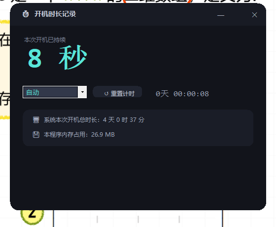

# UpTimeTracker · 开机时长记录

一款面向 Windows 的极轻量开机时长记录小工具。程序启动后自动开始计时，关闭后计时重置；时间单位可以自由切换——秒、分钟、小时、天，甚至**年**。整程序只有一个约 20 KB 的 exe，不依赖任何运行时安装包（使用 Windows 自带的 .NET Framework 4.8），常驻内存约 10–20 MB，并有工作集自动修剪，尽量不给电脑增加负担。



## 功能

- **单实例**：程序已在后台运行时，再次双击 exe 不会新开窗口，而是把已有实例从托盘唤醒到前台。
- **自动计时**：启动即从 0 开始计时；配合「开机自动运行」，开机后就会自动进入计时。
- **点 ✕ 后台运行**：点击关闭按钮默认最小化到托盘继续计时（首次会气泡提示）；在托盘菜单选「退出」才真正退出，此时**计时重置**。
  - 如果程序是异常退出（断电、崩溃），下次启动会自动续接上次的计时，不会丢失数据。
- **单位可选**：自动 / 秒 / 分钟 / 小时 / 天 / 年（按 365.2425 天折算）。
- **信息面板**：同时显示系统本次开机总时长、本程序当前内存占用；主界面提供「重置计时」按钮。
- **开机自启动**：界面内勾选即可，写入当前用户注册表 `HKCU\...\Run`，**无需管理员权限**；取消勾选即撤销。
- **托盘常驻**：点 ✕ 隐藏到托盘后台运行，双托盘图标恢复窗口，托盘菜单可重置计时或退出；也可取消勾选「点 ✕ 后最小化到托盘」恢复“点关闭即退出”。
- **窗口置顶**：可选项。

## 下载与运行

到 [Releases](../../releases) 下载 `UpTimeTracker.exe`，双击运行即可。

- 系统要求：Windows 10/11（.NET Framework 4.8 系统自带，无需安装任何东西）。
- 无安装、无后台服务、无联网行为。

## 从源码构建

需要任意一台 Windows 机器（无需安装 Visual Studio）：

```bat
build.bat
```

脚本调用系统自带的 `Csc.exe`（.NET Framework 4.8 编译器）编译出 `dist\UpTimeTracker.exe`。

## 技术说明

- 单文件 C# WinForms（`Program.cs`，C# 5 语法），零第三方依赖。
- 设置持久化为 `%APPDATA%\UpTimeTracker\settings.txt` 纯文本。
- 计时起点使用 UTC ISO 8601 存储，通过 `DateTimeOffset` 解析，跨时区 / 夏令时不会出错。
- 启动时与运行中每 5 分钟调用 `SetProcessWorkingSetSize` 修剪工作集，降低常驻内存。

## License

MIT
